# Flows

The six PRD flows and the five Stage 13 prototypes, with the package screen ID on every step. Click-through versions of the prototypes are in [03-prototype-flows](../03-prototype-flows/index.md).

## PRD flows

### 1. Project setup

```mermaid
flowchart LR
    s0["Client creates project and invites contractor<br/><code>WEB-CLIENT-003</code>"]
    s1["Contractor gets the WhatsApp invitation<br/><code>WA-CONTRACTOR-001</code>"]
    s2["Contractor accepts<br/><code>WEB-CONTRACTOR-001</code>"]
    s3["Contractor onboarding and payout account<br/><code>WEB-CONTRACTOR-002</code>"]
    s4["Contractor submits BoQ<br/><code>WEB-CONTRACTOR-004</code>"]
    s5["Ops assigns a vetted supervisor<br/><code>WEB-OPS-004</code>"]
    s6["Client pins site and draws geofence<br/><code>WEB-CLIENT-004</code>"]
    s7["Quote check<br/><code>WEB-CLIENT-006</code>"]
    s8["Client approves BoQ (contractor and ops too)<br/><code>WEB-CLIENT-005</code>"]
    s9["Client funds first milestone via Stripe into escrow<br/><code>WEB-CLIENT-007</code>"]
    s0 --> s1 --> s2 --> s3 --> s4 --> s5 --> s6 --> s7 --> s8 --> s9
```

Client creates project and invites contractor (`WEB-CLIENT-003`) → Contractor gets the WhatsApp invitation (`WA-CONTRACTOR-001`) → Contractor accepts (`WEB-CONTRACTOR-001`) → Contractor onboarding and payout account (`WEB-CONTRACTOR-002`) → Contractor submits BoQ (`WEB-CONTRACTOR-004`) → Ops assigns a vetted supervisor (`WEB-OPS-004`) → Client pins site and draws geofence (`WEB-CLIENT-004`) → Quote check (`WEB-CLIENT-006`) → Client approves BoQ (contractor and ops too) (`WEB-CLIENT-005`) → Client funds first milestone via Stripe into escrow (`WEB-CLIENT-007`)

### 2. Site visit

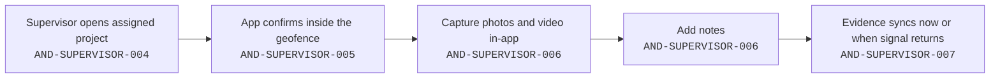

Supervisor opens assigned project (`AND-SUPERVISOR-004`) → App confirms inside the geofence (`AND-SUPERVISOR-005`) → Capture photos and video in-app (`AND-SUPERVISOR-006`) → Add notes (`AND-SUPERVISOR-006`) → Evidence syncs now or when signal returns (`AND-SUPERVISOR-007`)

### 3. Milestone release

```mermaid
flowchart LR
    s0["Contractor claims<br/><code>WEB-CONTRACTOR-005</code>"]
    s1["Supervisor verifies with checklist (three checks on evidence)<br/><code>AND-SUPERVISOR-008</code>"]
    s2["Client is told (WhatsApp)<br/><code>WA-CLIENT-001</code>"]
    s3["Client reviews milestone<br/><code>WEB-CLIENT-013</code>"]
    s4["Client approves in 3 taps<br/><code>WEB-CLIENT-014</code>"]
    s5["Escrow releases, receipt<br/><code>WEB-CLIENT-014</code>"]
    s6["Or: client disputes, release paused<br/><code>WEB-CLIENT-015</code>"]
    s7["Ops resolves (two approvers)<br/><code>WEB-OPS-006</code>"]
    s0 --> s1 --> s2 --> s3 --> s4 --> s5 --> s6 --> s7
```

Contractor claims (`WEB-CONTRACTOR-005`) → Supervisor verifies with checklist (three checks on evidence) (`AND-SUPERVISOR-008`) → Client is told (WhatsApp) (`WA-CLIENT-001`) → Client reviews milestone (`WEB-CLIENT-013`) → Client approves in 3 taps (`WEB-CLIENT-014`) → Escrow releases, receipt (`WEB-CLIENT-014`) → Or: client disputes, release paused (`WEB-CLIENT-015`) → Ops resolves (two approvers) (`WEB-OPS-006`)

### 4. Material order

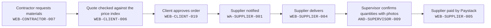

Contractor requests materials (`WEB-CONTRACTOR-007`) → Quote checked against the price index (`WEB-CLIENT-006`) → Client approves order (`WEB-CLIENT-019`) → Supplier notified (`WA-SUPPLIER-001`) → Supplier delivers (`WEB-SUPPLIER-004`) → Supervisor confirms quantities with photos (`AND-SUPERVISOR-009`) → Supplier paid by Paystack (`WEB-SUPPLIER-005`)

### 5. Weekly report

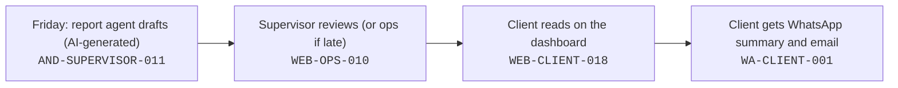

Friday: report agent drafts (AI-generated) (`AND-SUPERVISOR-011`) → Supervisor reviews (or ops if late) (`WEB-OPS-010`) → Client reads on the dashboard (`WEB-CLIENT-018`) → Client gets WhatsApp summary and email (`WA-CLIENT-001`)

### 6. Spot check

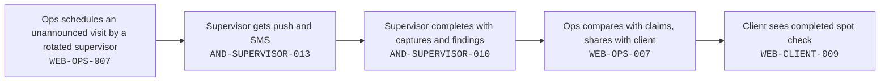

Ops schedules an unannounced visit by a rotated supervisor (`WEB-OPS-007`) → Supervisor gets push and SMS (`AND-SUPERVISOR-013`) → Supervisor completes with captures and findings (`AND-SUPERVISOR-010`) → Ops compares with claims, shares with client (`WEB-OPS-007`) → Client sees completed spot check (`WEB-CLIENT-009`)

## Stage 13 prototype flows

### A · Sign up to first funding

Click-through: [flow-a-sign-up-to-first-funding.html](../03-prototype-flows/flow-a-sign-up-to-first-funding.html)

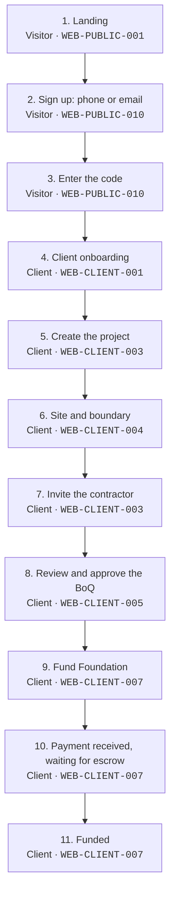

### B · Claim to release, every role

Click-through: [flow-b-claim-to-release.html](../03-prototype-flows/flow-b-claim-to-release.html)

```mermaid
flowchart TD
    p1["1. Contractor claims Roofing<br/>Contractor · app · <code>AND-CONTRACTOR-002</code>"]
    p2["2. Supervisor arrives on site<br/>Supervisor · app · <code>AND-SUPERVISOR-005</code>"]
    p3["3. Capture with the in-app camera<br/>Supervisor · app · <code>AND-SUPERVISOR-006</code>"]
    p4["4. Review and notes<br/>Supervisor · app · <code>AND-SUPERVISOR-006</code>"]
    p5["5. Sync: all accepted<br/>Supervisor · app · <code>AND-SUPERVISOR-007</code>"]
    p6["6. Verify Roofing<br/>Supervisor · app · <code>AND-SUPERVISOR-008</code>"]
    p7["7. Client: tap 1, the WhatsApp link<br/>Client · phone · <code>WA-CLIENT-001</code>"]
    p8["8. Client: tap 2, review<br/>Client · phone · <code>WEB-CLIENT-014</code>"]
    p9["9. Client: tap 3, confirm<br/>Client · phone · <code>WEB-CLIENT-014</code>"]
    p10["10. Releasing<br/>Client · phone · <code>WEB-CLIENT-014</code>"]
    p11["11. Released, with receipt<br/>Client · phone · <code>WEB-CLIENT-014</code>"]
    p12["12. Same milestone, four views · Client view<br/>All roles · <code>WEB-CLIENT-013</code>"]
    p13["13. Same milestone, four views · Contractor view<br/>All roles · <code>WEB-CONTRACTOR-005</code>"]
    p14["14. Same milestone, four views · Supervisor view<br/>All roles · <code>AND-SUPERVISOR-008</code>"]
    p15["15. Same milestone, four views · Ops view<br/>All roles · <code>WEB-OPS-004</code>"]
    p1 --> p2 --> p3 --> p4 --> p5 --> p6 --> p7 --> p8 --> p9 --> p10 --> p11 --> p12 --> p13 --> p14 --> p15
```

### C · Flagged evidence to ops decision

Click-through: [flow-c-flagged-evidence.html](../03-prototype-flows/flow-c-flagged-evidence.html)

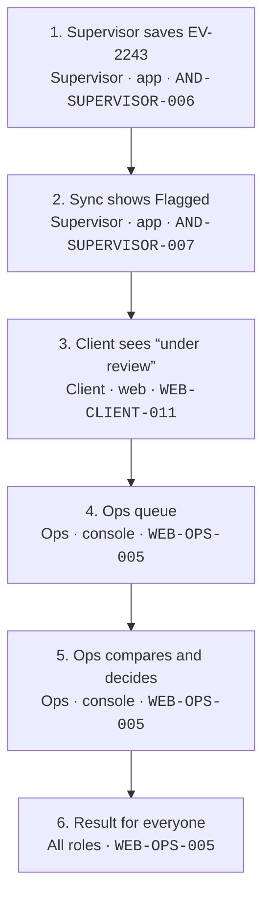

### D · Dispute to ops resolution

Click-through: [flow-d-dispute-resolution.html](../03-prototype-flows/flow-d-dispute-resolution.html)

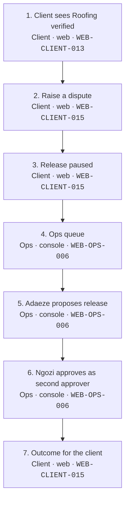

### E · Material order to supplier payout

Click-through: [flow-e-material-order-to-payout.html](../03-prototype-flows/flow-e-material-order-to-payout.html)

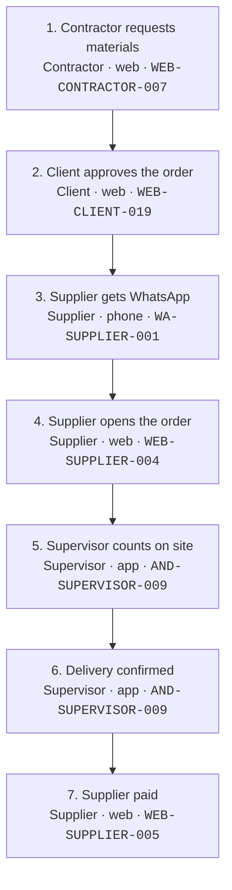
