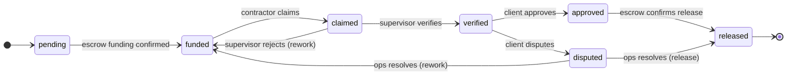
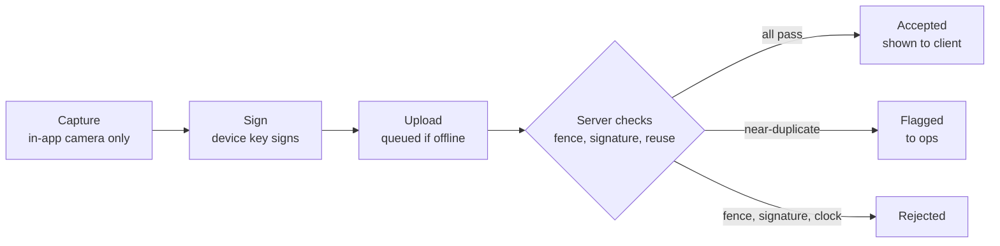

# iBackHome — Technical Specification

How we build what the PRD describes. Requirement IDs (FR-xx) refer to the PRD.

## Overview

iBackHome is a web app, an Android app and a set of AI agents on one FastAPI backend. The backend owns every rule that protects money and evidence; clients and agents only call its REST API.

| Layer | Choice | Notes |
| --- | --- | --- |
| Backend | Python 3.12, FastAPI, SQLAlchemy 2 (async), Alembic | One service, feature-based modules |
| Database | PostgreSQL 16 + PostGIS | Geofences, point-in-polygon, ledger |
| Jobs | Celery + Redis, Celery Beat | Reports, reminders, hash indexing, reconciliation |
| File storage | S3-compatible object storage | Photos and video, private, signed URLs |
| Web | Next.js (App Router) + TypeScript + Tailwind CSS | Client dashboard, contractor/supplier portals, ops console |
| Mobile | Flutter (Android 8+) | Supervisor and contractor app, offline-first |
| Payments | Stripe (foreign currency in), Paystack (NGN payouts), licensed escrow partner | We never hold client funds |
| Messaging | WhatsApp Business Cloud API, SMS provider, Firebase Cloud Messaging, email | One notifications module |
| AI | LLM API with tool calling | Tools are our own REST endpoints |
| Infra | Docker Compose, GitHub Actions | Staging from week two, production by day 15 |

**Scope of this spec**: the demo-day MVP (P0) in full; P1 items outlined; P2 items noted only.

**Assumptions**

- The base modules (users and roles, payments, notifications, geo, audit log) are built by our own team in `base/`; there is no cohort-wide starter repo. They are built first, on days 4–5, so every feature can use them.
- The escrow partner exposes an API for hold and release. Until it is ready, an `EscrowProvider` interface has a simulated implementation for the demo.
- All timestamps are stored in UTC; money is stored as integer minor units (kobo, pence, cents) with a currency code. No floats for money, ever.

## Code structure

Feature-based: one folder per product feature, matching the PRD modules, with the same small set of layered files inside each. Each person works mostly in their own folder, merge conflicts stay low, and a feature can be cut by removing one folder.

**Backend (FastAPI)**

```
backend/app/
├── core/                 # config, database session, security, common dependencies
├── base/                 # base modules, built by our team first
│   ├── users/            # auth, OTP, roles
│   ├── audit/            # append-only audit log
│   ├── payments/         # Stripe, Paystack, webhooks, ledger
│   ├── notifications/    # WhatsApp, SMS, push, email
│   └── geo/              # geofences, PostGIS helpers
├── features/
│   ├── projects/         # projects, sites, BoQ             (FR-03, FR-04, FR-05)
│   ├── evidence/         # upload, checks, hashing          (FR-06 to FR-10)
│   ├── milestones/       # claim, verify, approve           (FR-12)
│   ├── escrow/           # funding, release, disputes       (FR-13, FR-14)
│   ├── suppliers/        # orders, deliveries, price index  (FR-16, FR-17)
│   ├── supervision/      # vetting, spot checks, rotation   (FR-02, FR-11)
│   ├── reports/          # weekly reports                   (FR-18)
│   └── agents/           # report agent, quote checker, WhatsApp assistant
├── workers/              # Celery app and task registration
└── main.py               # includes every feature's router
```

Every feature folder has the same files:

```
features/milestones/
├── router.py      # API endpoints
├── schemas.py     # request and response shapes (Pydantic)
├── models.py      # database tables
├── service.py     # business rules, e.g. release needs both approvals
├── tasks.py       # background jobs for this feature (if any)
└── tests/
```

**Web (React)**

```
web/src/
├── app/                  # Next.js routes only (thin routing layer)
├── common/               # API client, auth, layout, map component, UI kit
└── features/
    ├── auth/
    ├── projects/         # setup, BoQ editor, geofence drawing
    ├── dashboard/        # client progress, spend, evidence gallery
    ├── milestones/       # approvals
    ├── suppliers/        # orders, price index
    ├── reports/
    └── ops-console/      # vetting, spot checks, disputes, live map
```

`app/` holds routes only (pages, layouts, route handlers); it imports from `features/` and `common/`, never the other way round.

**Mobile (Flutter)**

```
mobile/lib/
├── core/                 # API client, auth, offline storage, signing keys
└── features/
    ├── auth/
    ├── projects/         # assigned sites
    ├── capture/          # in-app camera, GPS, signing
    ├── sync/             # offline queue and upload
    ├── milestones/       # claim (contractor) and verify (supervisor)
    └── spot_checks/
```

**Rules**

1. Features talk to each other only through each other's `service.py`, never by querying another feature's tables.
2. Code used by two or more features goes in `core/` or `base/` (backend) or `common/` (web), not copied.
3. Only `base/payments` and `features/escrow` move money; pull requests touching them need two reviewers.
4. AI agents call the REST API, never services or the database directly.
5. Each feature keeps its own tests in its own `tests/` folder.

## Data model

All tables have `id` (UUID), `created_at` and `updated_at` (UTC). Money columns are `*_minor` (BIGINT) plus a `currency` (ISO 4217). Foreign keys shown as `→ table`.

| Table | Feature | Key fields |
| --- | --- | --- |
| `users` | base/users | phone, email, full_name, role (`client`, `contractor`, `supervisor`, `supplier`, `ops`), status (`active`, `suspended`), timezone, country |
| `otp_codes` | base/users | identifier (E.164 phone or lower-case email), channel (`sms`, `whatsapp`, `email`), code_hash (HMAC-SHA256, never the code), expires_at, attempts, consumed_at, requested_ip |
| `refresh_tokens` | base/users | user → users, token_hash (SHA-256, unique), expires_at, used_at, revoked_at, replaced_by → refresh_tokens |
| `supervisor_profiles` | supervision | user → users, registration_body, registration_no, guarantor_1, guarantor_2, registration_verified, nin_verified, guarantor_1_verified, guarantor_2_verified, vetting_status (`pending`, `approved`, `rejected`), vetted_by → users, vetted_at, rejection_reason, rating |
| `supervisor_relations` | supervision | supervisor → users, contractor_phone (E.164), relationship (declared relatives: a related supervisor can't be assigned to, or spot-check, that contractor's projects) |
| `suppliers` | suppliers | name, owner → users, address, location (POINT), verified, paystack_recipient_code |
| `projects` | projects | client → users, contractor → users, supervisor → users, title, address, status (`draft`, `boq_review`, `active`, `paused`, `completed`), currency, budget_minor |
| `sites` | projects | project → projects, location (POINT), geofence (POLYGON, SRID 4326) |
| `boq_items` | projects | project → projects, milestone → milestones (set when the BoQ is approved), milestone_sequence, milestone_name, line_no, description, unit, quantity (3 dp), unit_price_minor, total_minor, currency |
| `boq_approvals` | projects | project → projects, user → users, role (`client`, `contractor`, `ops`; one each), approved_at |
| `milestones` | milestones | project → projects, sequence, name, amount_minor, currency, status (see state machines), funded_at, claimed_at, verified_at, approved_at, released_at |
| `evidence` | evidence | project → projects, milestone → milestones (nullable), captured_by → users, captured_by_role (`supervisor`, `contractor`), kind (`photo`, `video`), storage_key (unique), content_type, size_bytes, file_sha256, captured_at (phone clock), gps_time (GPS fix), latitude, longitude, accuracy_m, device_id, signature, phash, status (`pending_checks`, `accepted`, `flagged`, `rejected`), reject_reason |
| `devices` | evidence | user → users, device_id, public_key, registered_at, revoked_at |
| `verifications` | milestones | milestone → milestones, supervisor → users, checklist (JSONB), notes, decision (`verified`, `rejected`) |
| `escrow_accounts` | escrow | project → projects (unique), provider, provider_account_ref, currency, balance_minor (cached; ledger is source of truth) |
| `escrow_releases` | escrow | milestone → milestones, amount_minor, status, provider_ref, requested_at, released_at |
| `disputes` | escrow | project → projects, milestone → milestones, raised_by → users, reason, status (`open`, `resolved_release`, `resolved_reject`), resolution_notes, resolved_by → users |
| `ledger_entries` | base/payments | transaction_id, account (e.g. `client_funding`, `escrow`, `contractor_payable`, `supplier_payable`, `fees`), direction (`debit`, `credit`), amount_minor, currency, fx_rate, ref_type, ref_id |
| `payment_events` | base/payments | provider (`stripe`, `paystack`, `escrow`), event_id (unique per provider; Paystack sends none, so ours is `<event>:<data.id>`), event_type, payload (JSONB), processed_at |
| `payout_recipients` | base/payments | user → users or supplier → suppliers (exactly one), provider (`paystack`), recipient_code (unique), bank_code, bank_name, account_name, account_number_masked (`******1234`; the full number is never stored), currency |
| `payouts` | base/payments | recipient → payout_recipients, provider, reference (ours, unique, so a retry never pays twice), amount_minor, currency, reason, status (`pending`, `success`, `failed`, `reversed`), provider_transfer_code, failure_reason, completed_at |
| `price_index_entries` | price_index | item_key, item, unit, price_minor, currency, supplier_name, supplier → suppliers (nullable), observed_on, source |
| `material_orders` | suppliers | project → projects, supplier → suppliers, requested_by → users, items (JSONB; quantity as a decimal string), total_minor (computed by the server), currency, status (`requested`, `approved`, `delivered`, `paid`, `cancelled`), approved_by → users, approved_at |
| `deliveries` | suppliers | order → material_orders, confirmed_by → users, quantities (JSONB), evidence_ids, confirmed_at |
| `spot_checks` | supervision | project → projects, supervisor → users, scheduled_by → users, scheduled_for, completed_at, findings |
| `reports` | reports | project → projects, week_start (a Monday; one report per project per week), body_md, pdf_key, evidence_ids, status (`draft`, `reviewed`, `sent`), sent_at |
| `agent_runs` | agents | agent, user → users (empty for scheduled runs), input (JSONB: system prompt, prompt, tools), tool_calls (JSONB), output, model (exact version), status (`succeeded`, `failed`), error, duration_ms, created_at |
| `audit_log` | base/audit | actor → users, action, object_type, object_id, before (JSONB), after (JSONB), ip, device_id, at — insert only |
| `idempotency_keys` | core | key, scope, status_code, response (the saved response a retried write replays) |
| `notifications` | base/notifications | user → users (nullable: login codes go to a raw phone or email), channel (`whatsapp`, `push`, `sms`, `email`: the one that delivered, or the last tried), template, payload (JSONB; never a login code; may hold the send key `_key`), recipient (the phone or email used), status (`sent`, `failed`), provider_ref, attempts, error (why channels failed), sent_at |

**Indexes that matter**: GiST on `sites.geofence`; unique on `payment_events (provider, event_id)`; btree on `evidence.phash` plus a BK-tree or prefix index for near-match search (see evidence integrity); `ledger_entries (ref_type, ref_id)`.

**Database protections**: `audit_log` and `ledger_entries` have no UPDATE or DELETE grants for the app role; a check constraint requires each `transaction_id` to balance (sum of debits = sum of credits), enforced in a deferred trigger.

### Entity relationship diagram

Every table hangs off `users` and `projects`: a project has one site, a set of milestones built from its BoQ, and everything else (evidence, verifications, releases, disputes, orders, spot checks, reports) attaches to the project or one of its milestones.

```mermaid
erDiagram
    USERS ||--o| SUPERVISOR_PROFILES : "has"
    USERS ||--o{ DEVICES : "registers"
    USERS ||--o{ SUPPLIERS : "owns"
    USERS ||--o{ PROJECTS : "client of"
    USERS ||--o{ PROJECTS : "contractor on"
    USERS ||--o{ PROJECTS : "supervises"
    PROJECTS ||--|| SITES : "located at"
    PROJECTS ||--o{ BOQ_ITEMS : "priced in"
    PROJECTS ||--o{ BOQ_APPROVALS : "approved by"
    USERS ||--o{ BOQ_APPROVALS : "gives"
    PROJECTS ||--o{ MILESTONES : "split into"
    MILESTONES ||--o{ BOQ_ITEMS : "groups"
    PROJECTS ||--o{ EVIDENCE : "has"
    MILESTONES |o--o{ EVIDENCE : "supported by"
    USERS ||--o{ EVIDENCE : "captures"
    DEVICES ||--o{ EVIDENCE : "signs"
    MILESTONES ||--o{ VERIFICATIONS : "checked by"
    USERS ||--o{ VERIFICATIONS : "verifies"
    PROJECTS ||--|| ESCROW_ACCOUNTS : "funded through"
    MILESTONES ||--o{ ESCROW_RELEASES : "paid by"
    MILESTONES ||--o{ DISPUTES : "contested in"
    PROJECTS ||--o{ DISPUTES : "has"
    USERS ||--o{ DISPUTES : "raises"
    SUPPLIERS ||--o{ PRICE_INDEX_ENTRIES : "quotes"
    PROJECTS ||--o{ MATERIAL_ORDERS : "orders"
    SUPPLIERS ||--o{ MATERIAL_ORDERS : "fulfils"
    MATERIAL_ORDERS ||--o| DELIVERIES : "confirmed by"
    USERS ||--o{ DELIVERIES : "confirms"
    PROJECTS ||--o{ SPOT_CHECKS : "inspected by"
    USERS ||--o{ SPOT_CHECKS : "performs"
    PROJECTS ||--o{ REPORTS : "reported in"
    USERS ||--o{ AGENT_RUNS : "triggers"
    USERS ||--o{ AUDIT_LOG : "acts in"
    USERS ||--o{ NOTIFICATIONS : "receives"

    USERS {
        uuid id PK
        string phone
        string email
        string full_name
        string role
        string status
        string timezone
    }
    SUPERVISOR_PROFILES {
        uuid id PK
        uuid user_id FK
        string registration_no
        bool nin_verified
        string vetting_status
    }
    DEVICES {
        uuid id PK
        uuid user_id FK
        string device_id
        string public_key
        timestamp revoked_at
    }
    SUPPLIERS {
        uuid id PK
        uuid owner_id FK
        string name
        geometry location
        bool verified
    }
    PROJECTS {
        uuid id PK
        uuid client_id FK
        uuid contractor_id FK
        uuid supervisor_id FK
        string status
        string currency
        bigint budget_minor
    }
    SITES {
        uuid id PK
        uuid project_id FK
        geometry location
        geometry geofence
    }
    BOQ_ITEMS {
        uuid id PK
        uuid project_id FK
        uuid milestone_id FK
        string description
        decimal quantity
        bigint unit_price_minor
    }
    BOQ_APPROVALS {
        uuid id PK
        uuid project_id FK
        uuid user_id FK
        string role
    }
    MILESTONES {
        uuid id PK
        uuid project_id FK
        int sequence
        string name
        bigint amount_minor
        string status
    }
    EVIDENCE {
        uuid id PK
        uuid project_id FK
        uuid milestone_id FK
        uuid captured_by FK
        string device_id FK
        timestamp captured_at
        string signature
        bigint phash
        string status
    }
    VERIFICATIONS {
        uuid id PK
        uuid milestone_id FK
        uuid supervisor_id FK
        jsonb checklist
        string decision
    }
    ESCROW_ACCOUNTS {
        uuid id PK
        uuid project_id FK
        string provider
        bigint balance_minor
    }
    ESCROW_RELEASES {
        uuid id PK
        uuid milestone_id FK
        bigint amount_minor
        string status
    }
    DISPUTES {
        uuid id PK
        uuid project_id FK
        uuid milestone_id FK
        uuid raised_by FK
        string status
    }
    PRICE_INDEX_ENTRIES {
        uuid id PK
        uuid supplier_id FK
        string item
        bigint price_minor
        timestamp observed_at
    }
    MATERIAL_ORDERS {
        uuid id PK
        uuid project_id FK
        uuid supplier_id FK
        bigint total_minor
        string status
    }
    DELIVERIES {
        uuid id PK
        uuid order_id FK
        uuid confirmed_by FK
        jsonb quantities
    }
    SPOT_CHECKS {
        uuid id PK
        uuid project_id FK
        uuid supervisor_id FK
        timestamp scheduled_for
    }
    REPORTS {
        uuid id PK
        uuid project_id FK
        date week_start
        string status
    }
    AGENT_RUNS {
        uuid id PK
        uuid user_id FK
        string agent
        jsonb tool_calls
    }
    AUDIT_LOG {
        uuid id PK
        uuid actor_id FK
        string action
        string object_type
        uuid object_id
    }
    NOTIFICATIONS {
        uuid id PK
        uuid user_id FK
        string channel
        string status
    }
    LEDGER_ENTRIES {
        uuid id PK
        uuid transaction_id
        string account
        string direction
        bigint amount_minor
        string ref_type
        uuid ref_id
    }
    PAYMENT_EVENTS {
        uuid id PK
        string provider
        string event_id
        jsonb payload
    }
```



`ledger_entries`, `payment_events` and `audit_log` point at many tables through `ref_type` / `ref_id` (or `object_type` / `object_id`) rather than a fixed foreign key, so they have no lines in the diagram. A project's site, escrow account and three people (client, contractor, supervisor) are each exactly one; everything else is one-to-many.

## State machines

Each state change happens only in that feature's `service.py`, is checked against the allowed transitions below, and writes an audit log entry. Any other transition is rejected with HTTP 409.

**Milestones**



| From | To | Who | Condition |
| --- | --- | --- | --- |
| `pending` | `funded` | system | Escrow funding for this milestone confirmed by webhook |
| `funded` | `claimed` | contractor | Project is `active` |
| `claimed` | `verified` | supervisor | Required evidence on the checklist is `accepted`; all captures inside the geofence |
| `claimed` | `funded` | supervisor | Supervisor rejects with a reason; contractor reworks and claims again |
| `verified` | `approved` | client | Client approves; no open dispute |
| `verified` | `disputed` | client | Client raises a dispute with a reason |
| `approved` | `released` | system | Escrow provider confirms the release |
| `disputed` | `released` | ops | Ops resolves in contractor's favour (two ops approvals) |
| `disputed` | `funded` | ops | Ops resolves as rework needed |

**Evidence**: `pending_checks` → `accepted` (all checks pass) · `pending_checks` → `rejected` (outside geofence, bad signature, or clock drift beyond limit) · `pending_checks` → `flagged` (near-duplicate image) · `flagged` → `accepted` or `rejected` (ops decision).

**Escrow releases**: `requested` → `submitted` (sent to provider) → `released` (provider confirms) or `failed` (retried up to 3 times, then ops alerted).

**Disputes**: `open` → `resolved_release` or `resolved_reject`. While a dispute is open, no release for that milestone can be requested.

**Projects**: a new project starts as `draft`.

| From | To | Who | Condition |
| --- | --- | --- | --- |
| `draft` | `boq_review` | contractor | Contractor submits the BoQ (project has a contractor) |
| `boq_review` | `draft` | client, contractor, ops | BoQ sent back for changes |
| `boq_review` | `active` | system | Client, contractor and ops have all approved the BoQ |
| `active` | `paused` | ops | Ops pauses the work |
| `paused` | `active` | ops | Ops resumes the work |
| `active` | `completed` | system | The last milestone has been released |

The site pin set with `PUT /projects/{id}/site` must lie inside the geofence polygon (422 `pin_outside_geofence`). The client can set or change the site only while the project is `draft` or `boq_review` (409 `site_locked` after that); ops can change it at any time. Every change is audited.
**BoQ rules**: each line's `total_minor` is computed by the server as quantity × unit_price_minor, rounded half-up to a whole minor unit (a sent `total_minor` must match, else 422 `boq_total_mismatch`). A milestone's amount is the sum of its lines; at most 20 milestones and 500 lines. A BoQ above the project's `budget_minor` is allowed and both figures are shown. The final approval needs a saved site (409 `site_not_set`); it creates the milestones (`milestones.create_for_project`), links each line to its milestone and makes the project `active`, in one transaction.

## API endpoints

REST over HTTPS, JSON, versioned under `/api/v1`. Auth with a bearer JWT. Errors follow one shape: `{"error": {"code": "milestone_not_verified", "message": "..."}}`. Every write endpoint accepts an `Idempotency-Key` header. Lists are paginated with `?cursor=&limit=`.

| Method | Path | Who | Purpose |
| --- | --- | --- | --- |
| POST | `/auth/otp/request` | anyone | Send OTP to phone or email |
| POST | `/auth/otp/verify` | anyone | Exchange OTP for access + refresh tokens |
| POST | `/auth/refresh` | signed in | New access token |
| GET | `/me` | signed in | Current user and role |
| POST | `/projects` | client | Create project, invite contractor |
| GET | `/projects`, `/projects/{id}` | parties, ops | List and view projects |
| PUT | `/projects/{id}/site` | client, ops | Set pin and geofence polygon (GeoJSON) |
| GET | `/projects/{id}/boq` | parties, ops | BoQ grouped by milestone, with totals, budget and approvals |
| PUT | `/projects/{id}/boq` | contractor | Submit BoQ items grouped into milestones; again while in review replaces it and clears approvals |
| POST | `/projects/{id}/boq/approve` | client, contractor, ops | Approve BoQ; project goes `active` when all three approve |
| POST | `/projects/{id}/supervisor` | ops | Assign a vetted supervisor |
| POST | `/devices` | supervisor, contractor | Register device public key |
| POST | `/devices/{id}/revoke` | the device's owner | Revoke a device key; its captures no longer verify |
| POST | `/evidence/upload-url` | supervisor, contractor | Get a pre-signed upload URL |
| POST | `/evidence` | supervisor, contractor | Submit capture metadata + signature after upload; runs checks |
| GET | `/projects/{id}/evidence` | parties, ops | Evidence gallery (signed read URLs) |
| POST | `/evidence/{id}/decision` | ops | Accept or reject flagged evidence (rejecting needs notes) |
| GET | `/projects/{id}/milestones` | parties, ops | The project's milestones in order, each with its newest verification |
| POST | `/milestones/{id}/claim` | contractor | Claim milestone done |
| POST | `/milestones/{id}/verify` | supervisor | Verify or reject with checklist |
| POST | `/milestones/{id}/approve` | client | Approve; triggers release request |
| POST | `/milestones/{id}/disputes` | client, contractor | Raise dispute |
| POST | `/disputes/{id}/resolve` | ops | Resolve (release or rework); needs two ops approvals |
| POST | `/projects/{id}/funding` | client | Create Stripe checkout for a milestone amount |
| GET | `/projects/{id}/ledger` | client, ops | Funding, releases and payouts |
| GET | `/price-index` | signed in | Current material prices |
| POST | `/projects/{id}/orders` | contractor | Request materials |
| POST | `/orders/{id}/approve` | client | Approve order |
| POST | `/orders/{id}/delivery` | supervisor | Confirm delivery with quantities + evidence |
| POST | `/quotes/check` | client, contractor, ops | Run quote checker on a quote or BoQ |
| GET | `/projects/{id}/reports` | parties, ops | Weekly reports |
| POST | `/reports/{id}/review` | supervisor (assigned), ops | Mark draft reviewed; queues send |
| GET | `/ops/queue` | ops | Vetting, flagged evidence, disputes |
| PUT, GET | `/supervisors/me/profile` | supervisor | Apply (or re-apply) for vetting; view own profile |
| POST | `/supervisors/{id}/vetting` | ops | Approve or reject vetting |
| GET | `/supervisors/me/spot-checks` | supervisor | Visits this supervisor still has to make |
| POST | `/spot-checks/{id}/complete` | supervisor (the visitor) | Record findings |
| POST | `/projects/{id}/spot-checks` | ops | Schedule an unannounced visit |
| GET | `/ops/audit` | ops | Search audit log |
| POST | `/webhooks/stripe`, `/webhooks/paystack`, `/webhooks/escrow` | providers | Signature-verified webhooks |
| POST | `/webhooks/whatsapp` | Meta | Incoming WhatsApp messages to the assistant |

FastAPI generates the OpenAPI document at `/docs`; the web and mobile API clients are generated from it so they stay in sync.

## Evidence integrity

The core promise: a photo or video in iBackHome was taken by a registered device, at the site, at the time it claims, and has not been used before.



**1. Capture (device)**

- The app uses the `camera` plugin directly; there is no gallery or file picker anywhere in the app (`image_picker` is not a dependency).
- At shutter: read GPS (lat, lon, accuracy, GPS time) and device time. Refuse capture if accuracy is worse than 50 m, or if Android reports the location as mocked.
- The app checks the geofence on device too, but only to warn the supervisor; the server decides.

**2. Sign (device)**

- On first login each install generates an ECDSA P-256 key pair in the Android Keystore (private key never leaves the device) and registers the public key via `POST /devices`.
- Canonical payload = SHA-256 of the file bytes + `captured_at` + lat + lon + accuracy + `project_id` + `device_id`, joined in a fixed order. The device signs it and stores file, metadata and signature together.

**3. Upload**

- The app asks for a pre-signed upload URL, uploads the file to object storage, then posts metadata and signature to `POST /evidence`.
- Offline captures wait in the sync queue (see mobile offline sync) and keep their original `captured_at` and location.

**4. Server checks (in this order; first failure decides)**

| Check | Rule | On failure |
| --- | --- | --- |
| File hash | Server recomputes SHA-256 of the stored file; must match the signed payload | `rejected` |
| Signature | Valid against the registered, non-revoked device key | `rejected` |
| Device owner | Device belongs to the user, who is a party to the project | `rejected` |
| Clock | `captured_at` within 10 min of GPS time; uploaded within 72 h of capture | `rejected` |
| Geofence | `ST_Contains(ST_Buffer(geofence, 25 m), point)` | `rejected` |
| Reuse | 64-bit perceptual hash (pHash); Hamming distance ≤ 8 against every stored image across all projects | `flagged` |

Video: pHash of a keyframe every 2 seconds; any keyframe match flags the video. Near-match search uses `bit_count(phash # candidate)` in Postgres, which is fast enough at pilot scale; switch to a BK-tree index if it grows.

**Other protections**: read URLs are signed and expire after 15 minutes; files are never public; personal EXIF data is stripped from what clients see; Play Integrity checks for rooted devices and emulators are a P1.

## Payments, escrow and ledger

iBackHome never holds client money. Funds go from the client (Stripe) to the licensed escrow partner, and out from the escrow partner to the contractor or supplier (Paystack, or the partner's own payout rail).

**Money flow**

1. Client funds a milestone: `POST /projects/{id}/funding` creates a Stripe Checkout session in GBP, USD or EUR for that milestone's amount plus fees.
2. Stripe webhook `checkout.session.completed` arrives: record ledger entries, instruct the escrow partner to hold the NGN equivalent, mark milestone `funded` when the partner confirms.
3. Milestone approved (or dispute resolved for release): create an `escrow_release`, call the partner's release API, mark `released` on its confirmation webhook.
4. Supplier orders: on confirmed delivery, a release goes to the supplier's Paystack recipient instead of the contractor.

**Escrow provider interface**

```python
class EscrowProvider(Protocol):
    async def hold(self, project_id, amount_minor, currency, ref) -> HoldResult: ...
    async def release(self, hold_ref, payee, amount_minor, ref) -> ReleaseResult: ...
    async def balance(self, project_id) -> Balance: ...
```

`SimulatedEscrow` implements it for staging and the demo; the real partner gets its own class once chosen. Nothing outside `features/escrow` knows which is in use.

**Ledger (double-entry)**

Every money event is one `transaction_id` with balanced entries in a single currency (a conversion is a pair of linked transactions). Example: client pays £1,000 for the foundation milestone.

| Transaction | Account | Debit | Credit |
| --- | --- | --- | --- |
| T1 · GBP (payment received) | `stripe_clearing:GBP` | £1,000 | |
| T1 · GBP | `client_funding:{project}:GBP` | | £1,000 |
| T2 · GBP (converted out) | `client_funding:{project}:GBP` | £1,000 | |
| T2 · GBP | `fx_conversion:GBP` | | £1,000 |
| T3 · NGN (held in escrow, `fx_rate` stored) | `escrow:{project}:NGN` | ₦ equivalent | |
| T3 · NGN | `fx_conversion:NGN` | | ₦ equivalent |

Release to contractor: debit `contractor_payable`, credit `escrow:{project}`; on payout confirmation, debit `escrow_payouts`, credit `contractor_payable`. Our fee is its own entry to `fees`.

**Webhooks and idempotency**

- Verify every webhook signature (Stripe signing secret, Paystack HMAC SHA-512, partner's scheme) before reading the body.
- Insert into `payment_events` with a unique `(provider, event_id)`; a duplicate insert means already processed, so return 200 and stop.
- Process inside one database transaction: ledger entries + state change + audit log together, or nothing.
- A nightly reconciliation job compares our ledger with Stripe, Paystack and the escrow partner and alerts ops on any difference.

**FX**: the rate used is stored on every entry at the moment of conversion; dashboards show both the client's currency and NGN.

## AI agents

Each agent is an LLM with tool calling, where every tool is an existing iBackHome API endpoint called with a scoped service token. Agents run in `features/agents`, are triggered by a Celery task or an incoming WhatsApp message, and log every run to `agent_runs`.

| Agent | Trigger | Tools (read-only unless noted) | Output |
| --- | --- | --- | --- |
| Report agent | Celery Beat, Friday 16:00 WAT, per active project | `get_project`, `list_milestones`, `list_evidence(since)`, `list_verifications(since)`, `get_ledger(since)`, `list_flags(since)`; write: `create_report_draft` | Markdown draft + PDF; the assigned supervisor (or ops) reviews before send |
| Quote checker | `POST /quotes/check` | `get_price_index`, `get_boq`; quote text extracted from PDF first | Lines flagged above index by > 15%, with index price and % difference; quantities outside plan range |
| Image stage check (P1) | After evidence `accepted` | Vision model on the image + claimed milestone | Stage estimate + confidence; a mismatch creates a flag for ops, never a rejection |
| WhatsApp assistant (P1) | `POST /webhooks/whatsapp` | `get_project`, `list_milestones`, `get_ledger`, `get_latest_report` for the sender's projects only | Short answer + dashboard link; hands off to ops on complaints or disputes |

**Guardrails (enforced in code, not only in prompts)**

- Agent service tokens carry an allow-list of tools; the API rejects any other call. No agent token can call approve, release, resolve or pay endpoints.
- Each agent acts as its own user with the `ops` role (no separate agent role); the sign-in check (`users.current_user`) lets a service token through only to the routes on its list, and refuses one whose user isn't an active ops user. Tokens last 10 minutes.
- The WhatsApp sender is matched to a user by phone number; tools are scoped to that user's projects.
- Numbers about money in any agent output must come from a `get_ledger` result in the same run; the report template fills money fields from data, not from the model.
- Each report cites the evidence IDs it used; the dashboard links them.
- Timeouts: 60 s per run, 10 tool calls max; failures fall back to a plain data summary and alert the team.
- Prompts and model version are stored per run so a report can be reproduced.

**Quote checker detail**: extract text with a PDF library, ask the model to return structured line items (item, unit, quantity, unit price) as JSON validated by a Pydantic schema, then compare against the price index in Python. The model parses; plain code decides what is flagged.

## Background jobs and notifications

**Jobs (Celery + Redis; schedules in Celery Beat, times in WAT)**

| Job | When | What it does |
| --- | --- | --- |
| `evidence.run_checks` | On each `POST /evidence` | Hash, signature, clock, geofence and reuse checks; sets status |
| `evidence.index_phash` | After acceptance | Adds hashes to the near-match index |
| `escrow.submit_release` | On approval or dispute resolution | Calls provider; retries 3 times with backoff, then alerts ops |
| `payments.reconcile` | Daily 02:00 | Ledger vs Stripe, Paystack, escrow partner; alerts on mismatch |
| `reports.generate_weekly` | Friday 16:00 | Runs report agent per active project |
| `reports.send_reviewed` | Every 15 min | Sends reports marked reviewed |
| `milestones.remind` | Daily 09:00 | Reminds clients of milestones waiting for approval over 48 h, supervisors of claims waiting over 24 h |
| `price_index.stale_check` | Weekly | Flags index items not updated in 14 days |
| `notifications.retry_failed` | Every 10 min | Retries failed sends, then falls back to the next channel |

All tasks are idempotent (safe to run twice) and take IDs, not objects, as arguments.

**Notifications**

One call: `notify(user_id, template, data, channels=None)`. If channels are not given, the user's preference order is used, falling back WhatsApp → push → SMS → email.

| Event | Client | Contractor | Supervisor | Ops |
| --- | --- | --- | --- | --- |
| Milestone claimed | WhatsApp | | push | |
| Milestone verified | WhatsApp + email | push | | |
| Release completed | WhatsApp + email | WhatsApp | | |
| Evidence flagged | | | push | console + email |
| Dispute opened | email | WhatsApp | | console + email |
| Weekly report ready | WhatsApp + email | | | |
| Spot check assigned | | | push + SMS | |

WhatsApp messages outside the 24-hour customer-service window must use Meta-approved templates, so templates are submitted for approval in week one.

## Auth, roles and permissions

**Login**: OTP by SMS or WhatsApp (Nigerian and international numbers, E.164) or email. OTPs are 6 digits, valid 5 minutes, max 5 attempts, rate-limited per phone and per IP. Codes are sent through `notify_address()` on exactly the channel asked for (no fallback); an unconfigured channel answers 503 `notifications_not_configured` and a provider failure 502 `notification_failed`, and no code is left waiting. Only `ENVIRONMENT=local` writes codes to the log. Successful login returns a 15-minute access JWT and a 30-day refresh token (rotated on use, stored hashed). Mobile keeps tokens in Android encrypted storage. The web app keeps them in httpOnly, secure, SameSite cookies set by its Next.js server, and the browser calls a same-origin proxy (`/api/v1/*`) that adds the bearer token, so browser JavaScript never sees a token.

**Authorisation** has two layers, both checked on every request:

1. **Role**: a FastAPI dependency such as `require_role("supervisor")`.
2. **Project membership**: the user must be the client, contractor or assigned supervisor of that project (ops can see all). Checked in the service layer, so it cannot be skipped by a new endpoint.

| Action | Client | Contractor | Supervisor | Supplier | Ops |
| --- | --- | --- | --- | --- | --- |
| Create project, set geofence | ✓ | | | | ✓ |
| Submit BoQ | | ✓ | | | |
| Approve BoQ | ✓ | ✓ | | | ✓ |
| Fund milestone | ✓ | | | | |
| Upload evidence | | ✓ (claims only) | ✓ | | |
| Claim milestone | | ✓ | | | |
| Verify milestone | | | ✓ (assigned only) | | |
| Approve milestone | ✓ | | | | |
| Raise dispute | ✓ | ✓ | | | |
| Resolve dispute | | | | | ✓ (two approvals) |
| Request materials | | ✓ | | | |
| Approve order | ✓ | | | | |
| Confirm delivery | | | ✓ | view | |
| Review weekly report | | | ✓ (assigned only) | | ✓ |
| Decide flagged evidence | | | | | ✓ |
| Vet supervisors, schedule spot checks | | | | | ✓ |
| View audit log | | | | | ✓ |

Contractor-uploaded evidence is labelled as such and never counts toward supervisor verification. A supervisor can never be assigned to a project where they are related to the contractor (declared at vetting) and is rotated after two consecutive milestones on the same project.

## Mobile offline sync

Building sites often have weak or no signal, so the supervisor app works fully offline for capture and syncs later.

**What is stored on the device** (local database such as Drift or Isar, encrypted):

- Assigned projects, sites, geofences, milestones and checklists, refreshed on every successful sync.
- A sync queue of pending actions: evidence captures (file path + metadata + signature), verification decisions, delivery confirmations.

**Queue rules**

- Each queued item gets a client-generated UUID, sent as the `Idempotency-Key`, so a retry never creates a duplicate.
- Items upload oldest first; a verification waits until all evidence it references has uploaded.
- Retries use exponential backoff (5 s up to 10 min) and resume when connectivity returns (`connectivity_plus` plus WorkManager for background upload).
- Photos are compressed to about 1600 px on the long edge, JPEG quality 80, before signing, so the signed file is exactly the uploaded file.
- Video is limited to 60 seconds at 720p.
- If a capture will be older than the 72-hour upload window, the app warns the supervisor at 48 hours.

**Conflicts**: the server is the source of truth. If a milestone changed state while the supervisor was offline (for example it was disputed), the queued verification is rejected with 409, the app shows why, and the evidence still uploads.

**Status in the app**: each capture shows queued, uploading, accepted, flagged or rejected, with the reason for a rejection.

## Environments, CI/CD, testing and observability

**Environments**

| Environment | Purpose | Payments | Data |
| --- | --- | --- | --- |
| Local | Docker Compose: web, api, worker, beat, postgres+postgis, redis, minio (S3) | Stripe and Paystack test keys, simulated escrow | Seed script |
| Staging | Daily 17:00 deploy, Sunday demos | Test keys, simulated escrow | Seed + simulator |
| Production | Pilot and demo day (from day 15) | Live keys, real escrow partner if ready | Real pilot data only |

Secrets live in environment variables from the host's secret store; `.env.example` lists every variable with no real values.

**CI (GitHub Actions) on every pull request**

1. Lint and format: `ruff` (Python), `eslint` + `prettier` (web), `dart analyze` (mobile).
2. Type checks: `mypy` on backend, `tsc` on web.
3. Tests against a real Postgres + PostGIS service container.
4. Alembic migration check: upgrade from empty and downgrade one step.
5. Build the API and web Docker images (the web image runs `next build`) and the Android debug APK.
6. Web tests: Vitest, then Playwright against `next build` + `next start`.

Merging to `main` deploys to staging; a tagged release deploys to production.

**Testing**

| Level | What | Must cover |
| --- | --- | --- |
| Unit | Services and pure functions | Every allowed and forbidden state transition; signature and clock checks; pHash distance; quote checker comparisons |
| Integration | API + real database | Geofence accept/reject at the boundary; permission matrix; idempotent webhooks (same event twice = one ledger entry); ledger always balances |
| End to end | Seeded staging | Full milestone flow: fund → capture → claim → verify → approve → release |
| Mobile | Widget + device tests | Offline capture, queue survives app restart, no gallery path |

Every code path that moves money must have tests before merge (programme rule).

**Observability**

- Structured JSON logs with a request ID that follows a request through API, worker and agent runs.
- Error tracking (for example Sentry) on API, worker, web and mobile.
- Health endpoint `/healthz` checks database, Redis and storage.
- Ops alerts (email + console) for: failed releases, reconciliation mismatches, flagged evidence, failed report runs.

## Open technical decisions

Each becomes an architecture decision record (ADR) in `docs/adr/` once decided.

| # | Decision | Options | Leaning | Decide by |
| --- | --- | --- | --- | --- |
| 1 | Base modules (users, payments, audit, geo, notifications) | Cohort starter repo; our own `base/` | Decided: each team builds its own; ours lives in `base/` | Done |
| 2 | Escrow partner | To be identified in week-one talks; simulated meanwhile | Simulated until a partner signs | Day 10 |
| 3 | Hosting | Render, Railway, Fly.io, a VPS with Docker | Decided 2026-10-16: staging is one VPS running the Docker Compose stack behind Caddy (HTTPS); `deploy/staging/`; the web app is a `web` container on the same stack, and Caddy routes the web hostname to it (2026-10-21) | Done |
| 4 | Object storage | AWS S3, Cloudflare R2, Backblaze B2 | Decided 2026-10-16: Cloudflare R2 (S3 API, no egress fees) | Done |
| 5 | SMS provider | Termii, Africa's Talking, Twilio | Local provider for Nigerian numbers | Day 5 |
| 6 | LLM provider and model | Any with tool calling and vision | Pick one with strong tool calling and image input | Day 12 |
| 7 | Mobile local database | Drift, Isar, Hive | Drift (SQL, good for queues) | Day 5 |
| 8 | Payout rail for contractors | Paystack transfers vs escrow partner's own payouts | Depends on decision 2 | Day 12 |
| 9 | Web framework | React + Vite SPA; Next.js (App Router) | Decided 2026-10-21: Next.js (App Router) + TypeScript + Tailwind CSS, with a same-origin auth proxy (BFF); ADR 0003 | Done |

Check current pricing and availability in Nigeria for the paid services before deciding.
